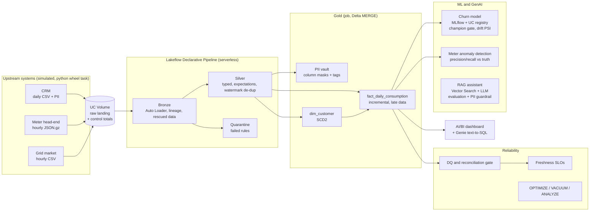

# Smart-Meter Lakehouse on Databricks

An end-to-end data and AI platform for a (fictional) Belgian energy supplier, built to run on
**Databricks Free Edition**. Hourly smart-meter telemetry, CRM data and grid market prices flow through
a governed medallion lakehouse into a star schema, data-quality gates, an ML churn model, meter anomaly
detection and a RAG customer-service assistant. Everything is deployed as code with
**Databricks Asset Bundles** and tested in CI.

> Built by Mohamed Mohseen (Senior Data Engineer, Databricks Certified Data Engineer Associate) to
> demonstrate production patterns used on IoT telemetry platforms. The data is synthetic (see ADR-0003).

## Architecture



## What this project demonstrates

| Skill | Where |
|---|---|
| Lakehouse / medallion, Delta Lake, PySpark, Spark SQL | `src/pipelines/medallion.py`, `src/smartmeter/transforms.py` |
| Incremental ingestion, streaming, watermarks, exactly-once | Auto Loader + `dropDuplicatesWithinWatermark` in the pipeline |
| Multi-source integration, upstream dependencies | 3 sources, task graph in `resources/daily_ingest.job.yml` |
| Data quality as code, quarantine | `src/smartmeter/quality.py` (shared by pipeline expectations and DQ job) |
| Reconciliation (source → bronze → silver → gold) | `src/smartmeter/reconcile.py`, `notebooks/03_data_quality_reconciliation.py` |
| Dimensional modelling, SCD2, incremental loads, late data | `src/smartmeter/scd2.py`, `notebooks/02_build_dimensional_model.py`, `docs/data_model.md` |
| Governance: Unity Catalog, PII masking, tags, GDPR erasure | `notebooks/00_setup_governance.py`, `notebooks/06_gdpr_erasure.py`, ADR-0002 |
| Monitoring, SLOs and SLAs, failure recovery | `notebooks/04_freshness_slo.py`, `docs/runbook.md`, job retries and alerts |
| Cost optimisation (FinOps) | `docs/finops.md`, `notebooks/05_maintenance_finops.py`, liquid clustering |
| CI/CD, multi-environment, Python wheel, IaC | `databricks.yml`, `resources/`, `.github/workflows/` |
| Automated testing | `tests/` (pytest + local Spark) |
| Glue → Databricks migration with parallel run | `legacy/`, `notebooks/40_migration_parallel_run.py`, `docs/migration.md` |
| Feature engineering, ML, MLflow, UC model registry, validation | `src/smartmeter/features.py`, `notebooks/10_*`, ADR-0004 |
| Batch scoring, drift monitoring, model serving | `notebooks/11_*`, `notebooks/13_*` |
| Anomaly detection with measured precision/recall | `notebooks/12_meter_anomaly_detection.py` |
| GenAI: RAG, Vector Search, LLM evaluation, guardrails | `src/smartmeter/rag.py`, `notebooks/20_*`, `notebooks/21_*` |
| BI and natural-language analytics | `dashboards/` (AI/BI dashboard, Genie space) |
| Local analytics without a cluster | `scripts/explore_local_duckdb.py` (DuckDB) |

## Repository layout

```
databricks.yml                  bundle: artifacts (wheel), variables, dev/prod targets
resources/                      schemas + volume, pipeline, jobs (all as code)
src/smartmeter/                 tested Python package (generator, quality, SCD2, features, RAG, ...)
src/pipelines/medallion.py      Lakeflow Declarative Pipeline: bronze -> silver
notebooks/                      job tasks: governance, gold, DQ, SLOs, ML, GenAI, migration
tests/                          pytest unit tests (local Spark)
docs/                           ADRs, runbook, FinOps, migration playbook, data model, RAG knowledge base
dashboards/                     AI/BI dashboard queries and Genie space setup
legacy/                         the AWS Glue job that was migrated
```

## Run it on Databricks Free Edition

1. Sign up at [Databricks Free Edition](https://www.databricks.com/learn/free-edition) and install the
   [Databricks CLI](https://docs.databricks.com/aws/en/dev-tools/cli/install).
2. Authenticate: `databricks auth login --host https://<your-workspace>.cloud.databricks.com`
3. Optional: create the salt secret: `databricks secrets create-scope smartmeter` and
   `databricks secrets put-secret smartmeter customer_key_salt`
4. Deploy and run:

```bash
databricks bundle validate
databricks bundle deploy -t dev
databricks bundle run daily_ingest -t dev      # first run backfills 120 days (~3M readings)
databricks bundle run ml_weekly -t dev         # churn model + scoring + drift
databricks bundle run genai_rag -t dev         # vector index + RAG evaluation
databricks bundle run migration_parallel_run -t dev
```

5. Build the dashboard from `dashboards/dashboard_queries.sql` and a Genie space from
   `dashboards/genie_space.md`.

In `dev` mode the bundle prefixes resources with `dev_<user>_` (e.g. `dev_mohamed_sm_gold`) and keeps
schedules paused. Free Edition has a daily fair-usage quota: keep `customers` at 1,000 or lower.

## Run the tests locally

```bash
python -m venv .venv && source .venv/bin/activate
pip install -e ".[dev]"     # needs Java 8/11/17 for local Spark
ruff check . && pytest
```

## Design decisions

* [ADR-0001](docs/adr/0001-medallion-pipeline-and-job-split.md) Declarative pipeline for bronze/silver, MERGE jobs for gold
* [ADR-0002](docs/adr/0002-pii-isolation-and-masking.md) PII vault, pseudonymisation, masking, erasure
* [ADR-0003](docs/adr/0003-synthetic-upstream-sources.md) Simulated upstream systems (Free Edition has no open internet)
* [ADR-0004](docs/adr/0004-model-lifecycle-and-promotion.md) Model lifecycle and champion/challenger promotion

## Free Edition notes

Serverless compute only, one Vector Search endpoint, a limited number of serving endpoints, at most
5 concurrent job tasks, and restricted outbound internet. The design respects all of these. Feature
availability changes over time; check the
[Free Edition limitations](https://docs.databricks.com/aws/en/getting-started/free-edition-limitations).
