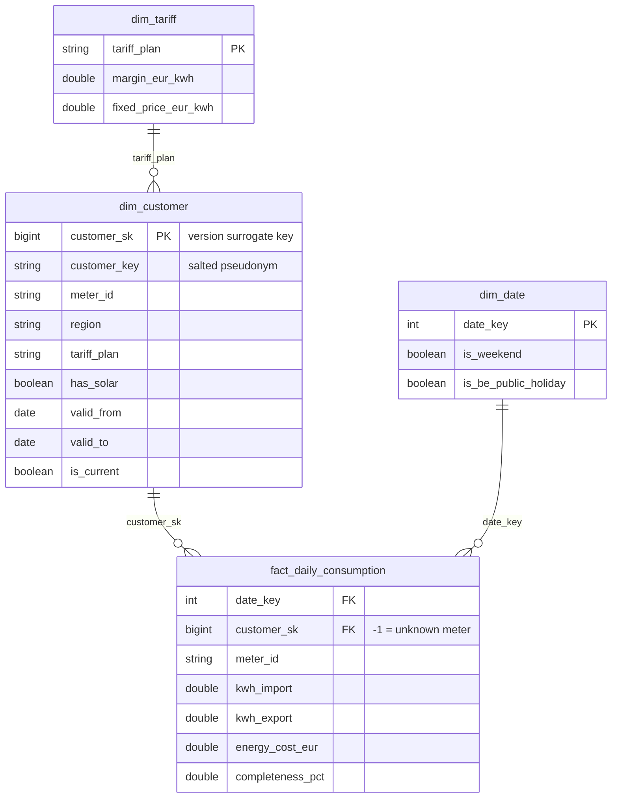

# Data model

| Table | Grain | Load pattern |
|---|---|---|
| `sm_gold.fact_daily_consumption` | meter × local day | incremental MERGE on touched dates |
| `sm_gold.dim_customer` | customer version | SCD2, one set-based MERGE per run |
| `sm_gold.dim_date`, `dim_tariff` | day / tariff | rebuilt (tiny) |
| `sm_gold.meter_anomalies` | meter × day flagged | `replaceWhere` on the lookback window |
| `sm_gold.churn_scores` | customer × cutoff | `replaceWhere` per cutoff |
| `sm_gold.grid_daily` | local day | rebuilt from silver |
| `sm_silver.customer_pii` | customer | upsert; masked; the only PII table |

**Design notes**
* The fact stores `region` and `tariff_plan` as of the reading day (degenerate attributes) to make common
  BI queries join-free; the authoritative history is in `dim_customer`.
* Unknown meters are kept with `customer_sk = -1` (unknown member) instead of being dropped, so energy
  totals reconcile with silver and the orphan rate is measurable.
* `expected_readings` is 23/24/25 depending on daylight saving, so completeness is correct all year.
